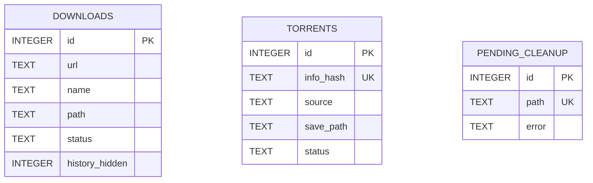

# Database Design — Nexus Downloader v10

## 1. Technology and location

The application uses Python's built-in `sqlite3`. The default path is `~/NexusDownloader/downloads.db` (`database/db.py`). The connection uses `check_same_thread=False`, a re-entrant lock around database operations, WAL mode, and `synchronous=NORMAL`.

There is no remote database, account table, or row-level security requirement in this local desktop product.

## 2. Existing tables

### `downloads`

| Column | Type / default | Meaning |
|---|---|---|
| `id` | INTEGER PRIMARY KEY AUTOINCREMENT | Local record ID |
| `url` | TEXT NOT NULL | Source URL |
| `name` | TEXT NOT NULL | Display/file name |
| `path` | TEXT NOT NULL | Destination path |
| `size` | INTEGER DEFAULT 0 | Total bytes when known |
| `downloaded` | INTEGER DEFAULT 0 | Recorded downloaded bytes |
| `status` | TEXT DEFAULT 'QUEUED' | Download lifecycle state |
| `created` | TEXT NOT NULL | Record creation timestamp |
| `started` | TEXT | Start timestamp |
| `completed` | TEXT | Completion timestamp |
| `duration` | REAL DEFAULT 0 | Duration summary |
| `avg_speed` | REAL DEFAULT 0 | Average speed summary |
| `peak_speed` | REAL DEFAULT 0 | Peak speed summary |
| `networks_used` | TEXT DEFAULT '' | Recorded network metadata |
| `network_bind_ip` | TEXT DEFAULT '' | Legacy compatibility field |
| `network_mode` | TEXT DEFAULT 'COMBINED' | Recorded network mode |
| `network_ips` | TEXT DEFAULT '' | Selected/used IP metadata |
| `connections` | INTEGER DEFAULT 0 | Per-download connection setting; 0 means not explicitly selected |
| `history_hidden` | INTEGER NOT NULL DEFAULT 0 | Hides completed record from History without deleting record/file |

The current code's migration strategy creates the table if absent and adds missing columns after inspecting `PRAGMA table_info`. Keep that compatibility behavior unless a tested migration system replaces it.

### `torrents`

| Column | Type / default | Meaning |
|---|---|---|
| `id` | INTEGER PRIMARY KEY AUTOINCREMENT | Local record ID |
| `info_hash` | TEXT UNIQUE NOT NULL | Torrent identity and duplicate prevention |
| `source` | TEXT NOT NULL | Magnet or torrent source reference |
| `name` | TEXT DEFAULT 'Torrent' | Display name |
| `save_path` | TEXT NOT NULL | Download destination |
| `total` | INTEGER DEFAULT 0 | Total bytes |
| `downloaded` | INTEGER DEFAULT 0 | Downloaded bytes |
| `status` | TEXT DEFAULT 'QUEUED' | Torrent lifecycle state |
| `created` | TEXT NOT NULL | Creation timestamp |
| `completed` | TEXT | Completion timestamp |
| `duration` | REAL DEFAULT 0 | Duration summary |
| `avg_download` | REAL DEFAULT 0 | Average download speed |
| `peak_download` | REAL DEFAULT 0 | Peak download speed |

### `pending_cleanup`

| Column | Type / default | Meaning |
|---|---|---|
| `id` | INTEGER PRIMARY KEY AUTOINCREMENT | Record ID |
| `path` | TEXT UNIQUE NOT NULL | Exact path awaiting cleanup |
| `error` | TEXT DEFAULT '' | Last recorded cleanup error, truncated by code |
| `created` | TEXT NOT NULL | Record creation timestamp |

## 3. Relationships and ER diagram

The current schema does not define foreign keys between these tables. Download records, torrent records, and cleanup records are managed independently.

## 4. Constraints and validation

- Use parameterized SQL for values; never interpolate user-provided data into SQL statements.
- Preserve unique `torrents.info_hash` and `pending_cleanup.path` constraints.
- Validate integer byte counts and connection counts at the application boundary.
- Treat status strings as a controlled set in application logic; document state transitions and test invalid transitions.
- Destination paths and cleanup paths must be validated independently of database storage.
- The database layer filters update keys through allowlists; retain that defense.

## 5. Indexes

The current schema does not declare additional explicit indexes. SQLite automatically indexes primary keys and the unique constraints. Before adding indexes, inspect actual query patterns (`all`, `queued`, `counts`, `history`, `get`, torrent list lookups) and benchmark realistic database sizes. Candidate indexes may include `downloads(status, id)` and `downloads(status, history_hidden, completed)` if measurements show a benefit. Do not add speculative indexes without evidence.

## 6. Ownership and authorization

All records belong to the local application profile. There are no multi-user ownership checks or row-level security policies. File-system permissions are the primary access boundary. Do not add authentication tables unless an approved remote/multi-user feature changes the product scope.

## 7. Sensitive data

URLs may contain signed query parameters or access tokens. Avoid logging complete URLs unnecessarily and never place credentials in bug reports. Database backups and shared diagnostics may contain private paths and URLs; document this before asking users to share them.

## 8. Migrations and seed data

- Existing database contents must be preserved across upgrades.
- Current migrations are additive column checks in `Database._init()`.
- Any new schema change requires a migration test against a copy of a pre-change database.
- Avoid seed data in production. Tests should use temporary database paths.
- New appearance preferences belong in the existing JSON settings file unless a concrete requirement makes a database table necessary.

## 9. Backup and recovery

Provide user-facing guidance for closing the app before copying the database and its SQLite WAL/SHM state, or use SQLite's backup API for a consistent backup. Never delete or overwrite the user's database during migration. Test recovery from a copy before changing migration behavior.
