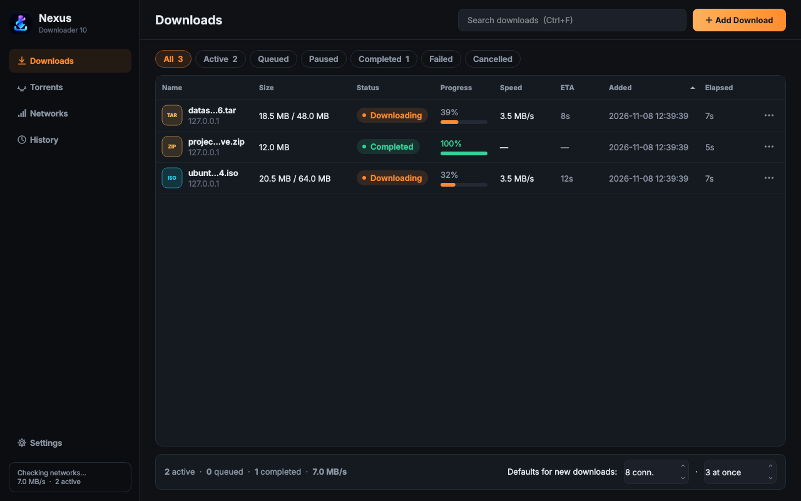
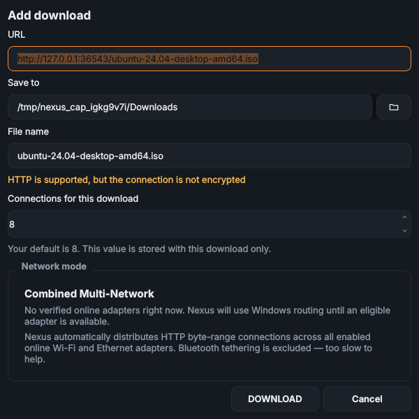
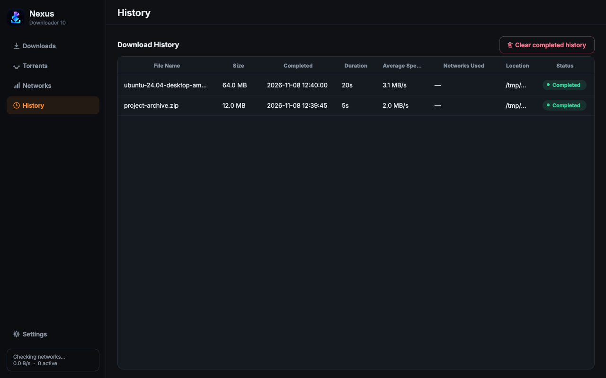
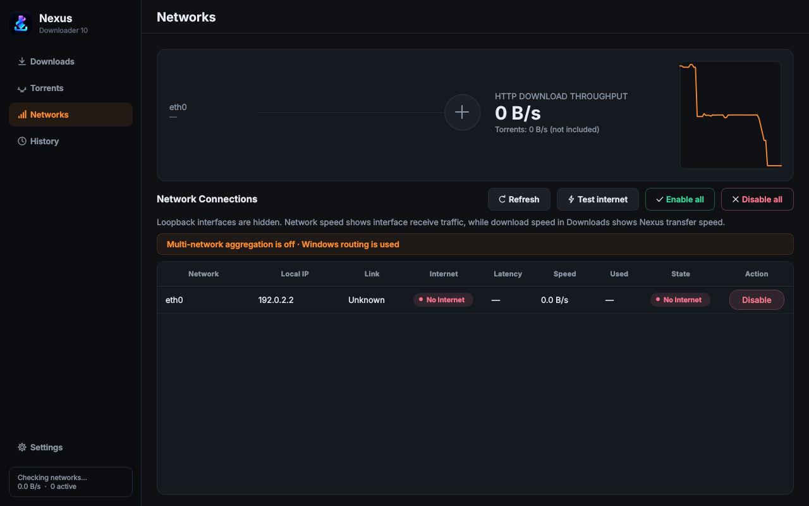
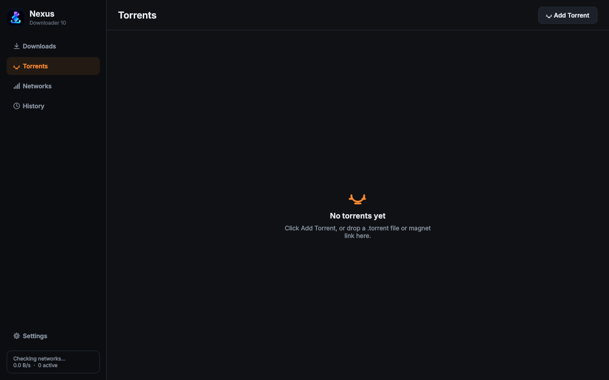
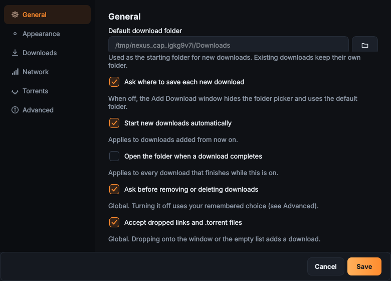
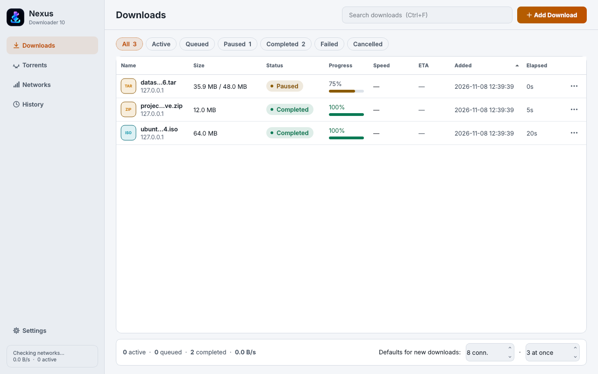
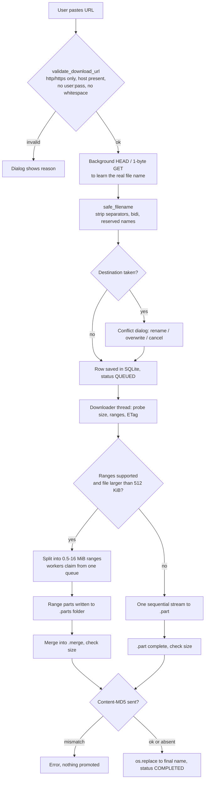
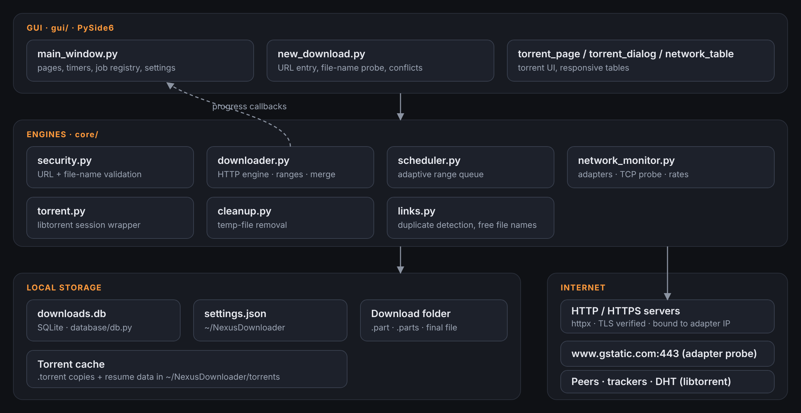

<div align="center">


# Nexus Downloader

**A fast, resumable desktop download manager for Windows, with multi-connection HTTP/HTTPS, optional multi-network downloads and built-in BitTorrent.**

   

[Install](#installation) · [Usage](#usage-guide) · [How it works](#how-nexus-downloader-works) · [Security](#security-and-privacy) · [Tests](#testing-and-quality)



</div>

> **Platform status.** Built for Windows (it ships `run_nexus.bat`). All automated tests and every screenshot here were produced on **Linux with Qt's offscreen renderer**; Windows runs, real-display DPI scaling and real multi-adapter hardware have **not** been verified by the author of this documentation.

## About the project

Nexus Downloader is a Python desktop application for people who download large files and want more control than a browser gives them: pausing and resuming, several connections per file, a clear queue, and a view of what each network adapter is doing. It also manages torrents in the same window.

Its main strengths, all present in the source:

- **Safe by construction for the common cases:** certificates are always verified, HTTPS links are never followed onto plain HTTP, remote file names are reduced to one safe path component, and a file only receives its final name once it is complete.
- **Real resume:** part files are reused only when the range layout and the remote file version still match.
- **Optional multi-network downloading:** one download can be split into byte ranges that are fetched through different network adapters and merged afterwards (see the limits below).
- **No hidden services:** no account, no update check, no analytics.

## Features

**Download management**
- Add by URL, paste or drag-and-drop; search, filter (All / Active / Queued / Paused / Completed / Failed / Cancelled).
- Pause, resume, cancel, retry; duplicate-link detection; rename / overwrite / cancel on name conflicts.
- Downloads to start automatically, "at once" limit (1–16), default connections per download (up to 32).

**HTTP / HTTPS**
- TLS verification on, redirect limit of 10, timeouts and bounded retries (both configurable), optional per-download speed limit.
- Real file name taken from `Content-Disposition` or the URL; `Content-MD5` verified when the server sends it.

**Multi-connection downloading**
- Files with byte-range support are cut into 0.5–16 MiB ranges that workers pull from one shared queue, then merged and size-checked.
- If a server's range answers cannot be trusted, the download falls back to one sequential stream.

**Multi-network**
- Adapters are listed with link, internet state, latency and receive rate; each can be enabled or disabled for Nexus (this only affects Nexus, never Windows).
- Workers are bound to an adapter's local IP; a scheduler gives ranges to the adapters that are actually finishing them faster.

**Torrent and magnet**
- libtorrent engine: magnet preview (metadata only, nothing written), file selection and priorities, renames, force-recheck, resume data, rate limits and listen port. Optional: the app runs without libtorrent and the Torrents tab says so.

**Resume and recovery**
- Partial files survive restarts; downloads that were running come back paused. A damaged database is quarantined and replaced instead of crashing the app.

**Progress, speed and ETA**
- Per-download progress, speed, ETA and elapsed time, plus total speed; History page for completed downloads.

**Network monitoring**
- Networks page with per-adapter state and a throughput graph; Refresh and Test internet buttons with visible progress and results.

**Appearance and settings**
- Dark (default), Light and System themes, accent colour, reduced motion; settings are saved in `settings.json`.

## Visual product gallery

| | |
|---|---|
| <br>**Active downloads** | <br>**Completed downloads** |
| <br>**Add Download** | <br>**History** |
| <br>**Networks** (sandbox: one adapter with no route to the probe host, so it shows "No Internet") | <br>**Torrents** (empty state) |
| <br>**Settings** | <br>**Light theme** |

Short capture of three downloads running against a local test server (real application, not an edit): 

Higher-quality version: [`docs/assets/project-demo.mp4`](docs/assets/project-demo.mp4). An interactive step-through of the download lifecycle and the trust boundaries: [`docs/visual-workflow/index.html`](docs/visual-workflow/index.html) (open it in a browser; it is a static page).

All screenshots use files served from `127.0.0.1` by a throttled local test server; no real sites or downloads are shown. A torrent screenshot with live peers and a multi-adapter capture were **not** produced.

## How Nexus Downloader works



Progress and speed are measured inside the download threads and handed to the GUI through callbacks; the GUI refreshes on Qt timers and never touches the network itself. Stop and pause close live responses so a blocked read wakes immediately. Resume state is the `.parts` folder plus a `layout.txt` that records size, range plan and the remote ETag/Last-Modified; on restart, parts are reused only if all of that still matches.



## Multi-network architecture

1. **Discovery.** `core/network_monitor.py` lists adapters with `psutil`, hides loopback and recognised hypervisor adapters (by MAC prefix), and tests each enabled adapter by opening a TCP connection to `www.gstatic.com:443` from that adapter's IPv4 address.
2. **Selection.** Adapters that are enabled, connected and online are eligible; Bluetooth is excluded; virtual adapters are off by default. With one eligible adapter a download is "single-network"; with two or more and a server that supports ranges it is "combined".
3. **Binding.** Each worker's `httpx` client uses `local_address=<adapter IP>`. There is no silent fallback to the default route for a chosen adapter, and environment proxies are bypassed for these requests so they cannot collapse onto one route.
4. **Scheduling.** `core/scheduler.py` keeps one queue of ranges. A worker may claim a range unless it would finish far later than the whole job should; an adapter that fails twice in a row is suspended with a growing cool-down; a worker hands a range back if another adapter is more than twice as fast.
5. **Metrics.** The Combiner view shows HTTP throughput, torrent throughput and unattributed traffic separately; an adapter nobody measures shows "—", not 0.
6. **Failure handling.** Per-range retries are bounded (6 attempts); the whole download fails only after that.

**Limits to understand.** This is application-level aggregation, not a bonded network adapter. The Networks table's *Speed* is the **whole interface's receive traffic**, including other programs; the Downloads page shows **Nexus's** transfer speed. Two adapters help only if they are independent paths to the server (two uplinks, not two links to the same router), the server must allow ranges, and on Windows a source-IP bind does not strictly force which NIC is used. Multi-network behaviour was measured only on a loopback simulator, **not on real Wi-Fi + tethering hardware**.

## Technology stack

| Technology | Role (from the source) |
|---|---|
| Python 3.13 (verified; 3.12 appears in CI config but was not run here) | Language |
| PySide6 (Qt for Python) | Desktop GUI, timers, signals |
| httpx (with httpcore, h11, certifi) | HTTP/HTTPS client: TLS verification, redirects, ranges, source binding |
| psutil | Adapter list, addresses, interface counters |
| libtorrent (optional) | BitTorrent engine, magnet handling, resume data |
| SQLite (`sqlite3`) | History, queue and torrent records (`downloads.db`) |
| `unittest` | Test framework; local mock HTTP servers and simulated adapters |
| Ruff | Lint (syntax and undefined-name rules only) |
| GitHub Actions | `tests.yml` and `lint.yml` workflows (configured; not run by the author of this document) |

## Architecture

```text
core/
  downloader.py      HTTP engine: probe, ranges, workers, merge, resume, integrity
  scheduler.py       Adaptive range queue for multi-adapter downloads
  network_monitor.py Adapter discovery, internet probe, rate attribution
  security.py        URL and file-name validation, HTTPS-downgrade guard
  links.py           Duplicate detection, non-overwriting paths, magnet hash
  cleanup.py         Removal of Nexus temp files only
  torrent.py         libtorrent session wrapper
database/db.py       SQLite access (parameterised)
gui/                 main window, tables, dialogs, theme, icons
tests/               unittest suites + local servers and adapter simulator
docs/                assets, diagrams, interactive workflow page
```

## Installation

**Requirements:** Windows is the target platform. Python 3.13 was used for all verification (the batch file asks for 3.10+, which was not tested). libtorrent installs from a wheel only for some Python versions; without it everything except torrents works.

```bat
:: easiest: double-click run_nexus.bat (creates .venv, installs requirements, starts the app)
```

Manual setup:

```bash
python -m venv .venv
.venv\Scripts\activate          # Windows;  source .venv/bin/activate on Linux
python -m pip install -r requirements.txt
python main.py
```

Configuration: no environment variables are required. Settings live in `~/NexusDownloader/settings.json` and the database in `~/NexusDownloader/downloads.db`. Linux and macOS are not supported targets; the Linux run used for testing needs `QT_QPA_PLATFORM=offscreen` for headless use.

## Usage guide

1. **Start** with `run_nexus.bat` or `python main.py`.
2. **Add a download:** *Add Download* (Ctrl+N) or drop a link on the window. The dialog suggests the real file name; choose a folder and the number of connections.
3. **Start, pause, resume, cancel:** use the row buttons or the **⋯** menu. Downloads start automatically unless you turn that off in Settings.
4. **Read the table:** *Progress* is completed bytes, *Speed* is Nexus's transfer rate, *ETA* is estimated from the recent rate.
5. **Networks:** open the page, press *Refresh* (re-scan adapters) or *Test internet* (probe each enabled adapter); the result line under the buttons says what happened. *Disable* / *Enable* decides whether Nexus may use that adapter.
6. **Torrents:** *Add Torrent* accepts a magnet link or a `.torrent` file; choose files and priorities before it starts.
7. **Settings** (sidebar): General, Appearance, Downloads, Network, Torrents, Advanced.

## Security and privacy

A security review of the current source is in [SECURITY_AUDIT.md](SECURITY_AUDIT.md), the threat model in [SECURITY_MODEL.md](SECURITY_MODEL.md), and the commands and results in [SECURITY_TEST_RESULTS.md](SECURITY_TEST_RESULTS.md). Summary:

- **Controls:** TLS verified, http/https only, HTTPS never followed to HTTP, safe file names, no overwrite without consent, complete files only under the final name, parameterised SQL, nothing executed automatically, no administrator rights.
- **Two defects found and fixed in this review:** a plain-HTTP request was sent before an HTTPS→HTTP redirect was refused, and the optional Windows Defender scan could treat a crafted file name as script text (the Windows part is not yet run on Windows).
- **What leaves your machine:** the URLs you download, a TCP connection to `www.gstatic.com:443` from each enabled adapter every few seconds (cannot be switched off), and torrent traffic. There is no telemetry or update check.
- **Honest limits:** downloads are only integrity-checked if the server sends `Content-MD5`; torrents expose your IP, listen on all interfaces and use libtorrent defaults (DHT, local discovery, UPnP); a verified torrent can still be malware; local history is stored unencrypted. The application is **not** security-certified.

Report problems privately as described in [SECURITY.md](SECURITY.md).

## Testing and quality

- Framework: `unittest`, with local HTTP servers, a simulated adapter layer and Qt's offscreen platform.
- Last full run of this source: **251 tests in 16 modules, 0 failures, 0 skipped**, Python 3.13.16 on Linux (headless). Ruff and `pip check` clean; `pip-audit` reported no known vulnerabilities on 2026-11-08.
- Covers the HTTP engine, ranges and resume, the scheduler and simulated multi-adapter runs, torrent flows, integrity, database recovery, theming, responsive layout of every page and dialog, and the security regressions.
- **Not verified:** Windows execution, real display DPI scaling, real multi-adapter hardware, real torrent swarms.

```bash
QT_QPA_PLATFORM=offscreen python -m unittest discover -s tests -v
```

## Project structure

```text
Nexus-Downloader/
├── main.py  run_nexus.bat  requirements.txt  requirements-dev.txt  pyproject.toml
├── core/  database/  gui/  tests/  assets/
├── docs/assets/  docs/diagrams/  docs/visual-workflow/  docs/security-repro/
└── README.md  SECURITY.md  SECURITY_AUDIT.md  SECURITY_MODEL.md  SECURITY_TEST_RESULTS.md
    CONTRIBUTING.md  CODE_OF_CONDUCT.md  TROUBLESHOOTING.md  THIRD_PARTY_NOTICES.md  LICENSE
```

## Roadmap

Only items already recorded in [ROADMAP.md](ROADMAP.md): Windows verification of the full test suite; a user-supplied SHA-256 field; per-adapter throughput that also covers single-connection jobs; Windows + Linux CI; packaged builds after per-OS verification. From the security review: switches for the connectivity probe and for torrent DHT/UPnP/interface binding, and hash-locked dependencies.

## FAQ

**Does using two networks always make a download faster?** No. It helps when two independent paths reach the server and the server supports byte ranges.

**Does Nexus change my Windows network settings?** No. Enabling or disabling an adapter on the Networks page only decides whether Nexus uses it.

**Why does a finished download not appear until the end?** Data is written to `.part` / `.parts` and renamed only when complete and checked.

**Can I turn off the periodic network test?** Not in this version; you can lengthen the interval (1–15 s) in Settings → Network.

**Is a torrent that finishes "verified" safe?** No. Verification means the data matches what the publisher shared.

**What are `.part` and `.parts`?** Temporary files next to the destination; they are what resume uses. Removing a download removes only files Nexus created.

**Where is my data?** `~/NexusDownloader` (settings, database, torrent cache).

## License and acknowledgements

MIT License, "Copyright (c) 2026 Nexus Downloader Contributors" (see [LICENSE](LICENSE); the copyright holder wording has not been confirmed by the owner). Dependencies keep their own licenses: [THIRD_PARTY_NOTICES.md](THIRD_PARTY_NOTICES.md). The origin and license of the logo files in `assets/` are recorded there as **unresolved**.

Built with PySide6 / Qt, httpx, psutil and libtorrent.
