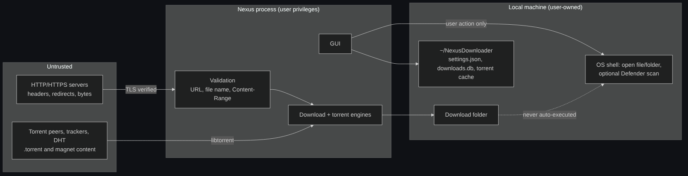
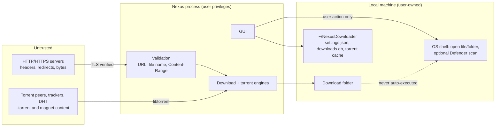

# Nexus Downloader v10 — Security Model

How the current source is meant to be trusted, and where it is not. Findings and evidence: [SECURITY_AUDIT.md](SECURITY_AUDIT.md).

## 1. Security goals

1. Downloaded data must not be able to write outside the folder the user chose.
2. A file must not appear under its final name until it is complete (and verified when the server gives a hash).
3. An HTTPS download must stay on HTTPS, with certificates verified.
4. Nothing downloaded is executed automatically.
5. Nexus does not change the user's network configuration, and requests no administrator rights.
6. Local state is not sent anywhere.

Non-goals: protecting against malware inside a downloaded file, hiding the user's IP from servers or torrent peers, protecting local files from other software running as the same user, multi-user isolation.

## 2. Assets

User files and folders; signed download URLs; download history; settings; torrent resume data; the user's session (code execution as the user); network privacy.

## 3. Trust boundaries

## 4. Threat actors

Malicious or compromised web servers and CDNs; on-path network attackers; malicious torrents and swarm peers; a compromised dependency; a local attacker who can already write to the user's profile; the user's own mistakes (opening a downloaded executable).

## 5. Entry points and data flows

- **URL / drop / paste → validation (`core/security.py`) → file-name probe (`gui/new_download.py`) → `safe_filename` → SQLite row → downloader thread → network → `.part`/`.parts` → merge → verify → `os.replace` → final file.**
- **Torrent file / magnet → libtorrent (`core/torrent.py`) → metadata preview (no files written) → user selection → libtorrent writes files under the chosen folder.**
- **Adapter probe:** `psutil` adapter list → TCP connect to `www.gstatic.com:443` from each adapter's IP → Networks page and adapter selection.
- **Progress:** engine threads → callbacks → GUI timers (no network access from the GUI thread).

## 6. Trust assumptions

**Network.** Servers are untrusted: every header and byte is input. Certificates are verified against the Python `certifi` bundle (or `SSL_CERT_FILE`/`SSL_CERT_DIR` if the user sets them, because the default `httpx` client trusts the environment). Plain-HTTP links that the user types are allowed and carry no protection; the UI labels them "HTTP (unencrypted)". HTTPS links are never followed to HTTP. Environment proxy variables are honoured for the default route; explicit multi-adapter requests bypass them on purpose.

**File system.** The destination folder is chosen by the user and trusted. Remote-supplied names are not trusted and are reduced to a single safe path component. Other software running as the same user is trusted (it could change the files anyway).

**Torrents.** Metadata and peers are untrusted; libtorrent is trusted to sanitise paths and verify piece hashes. A verified torrent is still untrusted content.

**Privacy.** Local files stay local. Leaving the machine: requests for the URLs the user downloads, the periodic connectivity probe, and torrent traffic.

## 7. Controls currently implemented

| Control | Where |
|---|---|
| TLS verification on every client; no bypass option | `core/downloader.py::_client`, `gui/new_download.py` |
| HTTPS→HTTP downgrade refused **before** the request is sent | `core/security.py::refuse_https_downgrade` |
| Scheme allow-list, host required, no embedded credentials, length cap | `core/security.py::validate_download_url` |
| Redirect limit (10), timeouts, bounded retries and back-off | `core/downloader.py` |
| `Content-Range`, `If-Range`, size and layout validation; sequential fallback on range violations | `core/downloader.py` |
| Safe file names (separators, bidi, reserved names, length) | `core/security.py::safe_filename` |
| Atomic promotion, no silent overwrite, Content-MD5 when sent | `core/downloader.py`, `core/links.py` |
| Cleanup limited to Nexus temp files; links never followed | `core/cleanup.py` |
| Parameterised SQL, allow-listed column names, corrupt-DB quarantine | `database/db.py` |
| Defender scan path passed as data, not script | `gui/main_window.py` |
| No auto-execution, no admin request, no network configuration changes | whole code base |

## 8. Controls that are missing

- No way to disable the `www.gstatic.com` probe.
- No torrent switches for DHT / local discovery / UPnP, no interface binding for torrents, upload unlimited by default.
- No user-supplied checksum; MD5 only when the server provides it.
- No size cap or free-space floor for responses of unknown length.
- No warning before opening an executable file type.
- Dependencies are not pinned or hash-locked.
- Local data is not encrypted.

## 9. Known limitations

The model cannot protect against what is inside a file. Windows behaviour (PowerShell, reserved names inside libtorrent, UAC) was not executed in the audit. Loopback and simulated-adapter tests do not prove behaviour on real multi-adapter hardware.
